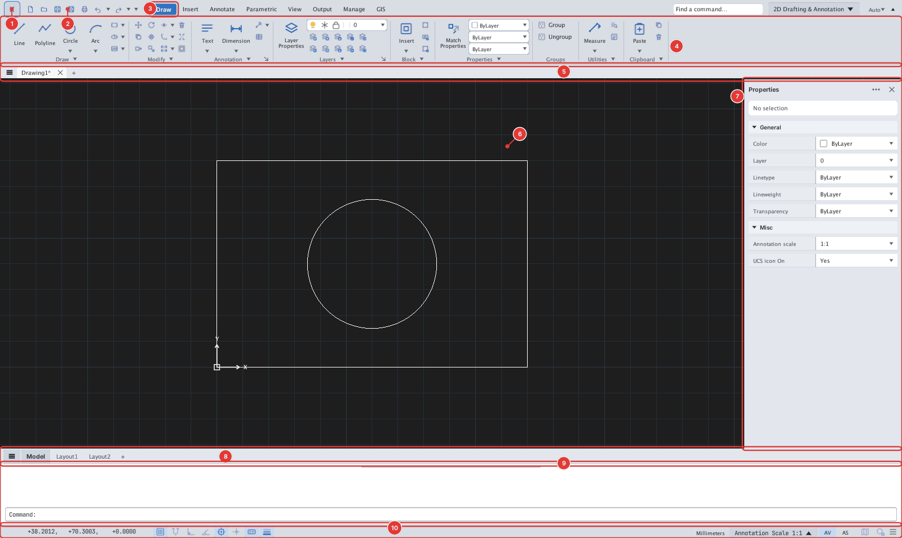
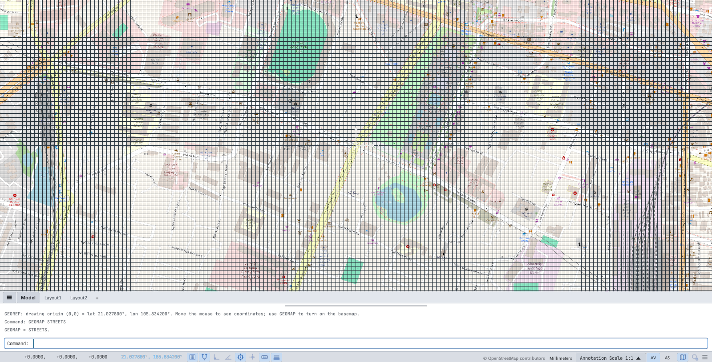

<p align="center">
  
</p>

<h1 align="center">KUFCAD</h1>

<p align="center">
  <b>Phần mềm vẽ kỹ thuật 2D miễn phí, cách dùng giống AutoCAD, đọc/ghi trực tiếp DWG/DXF.</b><br>
  Free 2D drafting software with an AutoCAD-style workflow and native DWG/DXF support.
</p>

<p align="center">
  <a href="https://github.com/minhnt152/kufcad-releases/releases/latest"></a>
</p>

<p align="center">
  🌐 <a href="https://cad.kufautomation.com"><b>cad.kufautomation.com</b></a> &nbsp;·&nbsp;
  🌐 <a href="https://cad.mashtool.com"><b>cad.mashtool.com</b></a>
</p>

<p align="center"><b>FREE FOREVER</b></p>



---

## Tải về

Vào trang **[Releases](https://github.com/minhnt152/kufcad-releases/releases/latest)** và chọn bản theo máy:

| Hệ điều hành | File | Yêu cầu |
|---|---|---|
| **Windows** | `KufCad-vX.Y-Windows-x64-Setup.exe` | Windows 10/11 64-bit, card đồ hoạ hỗ trợ DirectX 12 / Vulkan / OpenGL |
| **macOS** | `KufCad-vX.Y-macOS-universal.zip` | macOS 11 trở lên, Apple Silicon hoặc Intel |

Mỗi bản phát hành kèm file `SHA256SUMS.txt` để kiểm tra file tải về.

### Cài đặt trên Windows

Chạy `KufCad-vX.Y-Windows-x64-Setup.exe` và làm theo hướng dẫn. Không cần quyền admin;
KufCad được cài vào `%LOCALAPPDATA%\Programs\KufCad`, có lối tắt ở Start Menu / Desktop và gỡ được trong
**Settings ▸ Apps**.

Windows SmartScreen có thể cảnh báo (bản chưa ký số): bấm **More info ▸ Run anyway**.

### Cài đặt trên macOS

1. Giải nén, kéo **KufCad.app** vào thư mục **Applications**.
2. Lần đầu mở: chuột phải **KufCad.app ▸ Open ▸ Open** (bản chưa ký Apple Developer ID).
3. Nếu macOS báo *"app is damaged"*, mở Terminal và chạy:
   ```bash
   xattr -cr /Applications/KufCad.app
   ```

## Tính năng chính

- **DWG / DXF** — mở và lưu trực tiếp, không cần chuyển đổi.
- **Thao tác như AutoCAD** — dòng lệnh với alias quen thuộc (`L`, `C`, `TR`, `O`…), ribbon, Properties, grips, Object Snap, Polar/Ortho, Dynamic Input.
- **Vẽ & hiệu chỉnh 2D đầy đủ** — Line, Polyline, Arc, Spline, Hatch, MLine, Revcloud…; Trim, Extend, Offset, Fillet, Array, Stretch…
- **Ghi chú** — Text/MText, Dimension, Leader/MLeader, Table, Field, kiểu chữ SHX/TTF.
- **Block, Xref, Attribute**, Layer & Layer States, Linetype, Lineweight.
- **Parametric** — ràng buộc hình học và kích thước.
- **Layout & in ấn** — Viewport, Page Setup, Plot/Publish ra PDF, bảng nét CTB/STB.
- **GIS** — bản đồ nền trực tuyến, georeference, nhập/xuất GeoJSON / KML / SHP.
- **Lập trình mở rộng** — LISP, VBA, .NET (C#), Script, và máy chủ MCP cho trợ lý AI.
- **Nhanh với bản vẽ lớn** — vẽ bằng GPU (DirectX/Vulkan/Metal).
- **Hướng dẫn sử dụng** song ngữ Việt/Anh có sẵn trong phần mềm — nhấn **F1** hoặc gõ `HELP`.



## Liên kết

- Trang chủ: **https://cad.kufautomation.com**
- Trang dự phòng: **https://cad.mashtool.com**
- Báo lỗi / góp ý: mở mục [Issues](https://github.com/minhnt152/kufcad-releases/issues).

---

## English

**KufCad** is a free, GPU-accelerated 2D CAD application with an AutoCAD-like workflow
(command line, aliases, ribbon, grips, object snaps) that reads and writes **DWG/DXF** natively.

**Download:** grab the latest build from **[Releases](https://github.com/minhnt152/kufcad-releases/releases/latest)**.

- **Windows 10/11 x64:** run the installer `KufCad-vX.Y-Windows-x64-Setup.exe` (per-user, no admin rights needed).
  If SmartScreen warns, click **More info ▸ Run anyway**.
- **macOS 11+ (Apple Silicon & Intel):** unzip `KufCad-vX.Y-macOS-universal.zip`, move **KufCad.app** to Applications,
  then right-click ▸ **Open** the first time (the app is not yet notarized). If macOS says the app is damaged,
  run `xattr -cr /Applications/KufCad.app`.

Highlights: full 2D draw/modify toolset, dimensions & annotation, blocks/xrefs, parametric constraints,
layouts with Plot/Publish to PDF, GIS basemaps & georeferencing, LISP / VBA / .NET / MCP automation,
and a built-in bilingual (Vietnamese/English) manual (**F1**).

Website: **https://cad.kufautomation.com** · **https://cad.mashtool.com**

---

<sub>Repo này chỉ chứa bộ cài phát hành; mã nguồn không công khai. · This repository hosts release binaries only; the source code is not public.</sub>
